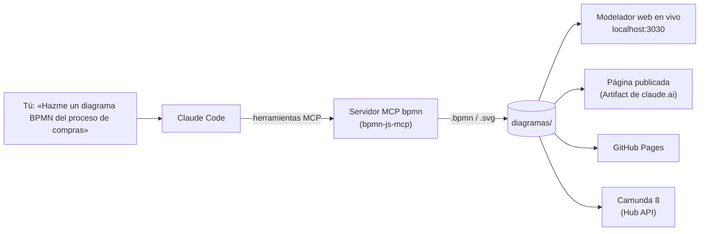
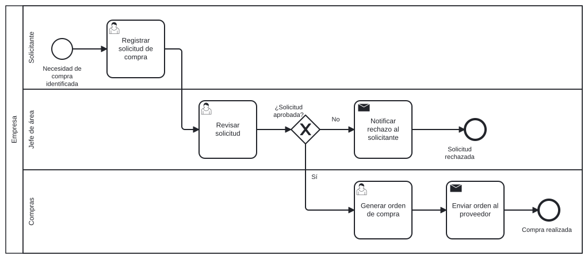

# Modelador BPMN 2.0 con Claude Code

Pídele a Claude un diagrama BPMN 2.0 en el chat y **míralo dibujado en un
modelador en línea**: el modelador web de este proyecto (que se actualiza en
vivo mientras Claude dibuja), una página publicada, GitHub Pages o el modelador
web de **Camunda**.



Ejemplo generado por Claude con el MCP ([`diagramas/solicitud-de-compra.bpmn`](diagramas/solicitud-de-compra.bpmn)):



## Cómo funciona

1. **Describes el proceso** en lenguaje natural.
2. Claude usa el **servidor MCP `bpmn`**
   ([bpmn-js-mcp](https://github.com/datakurre/bpmn-js-mcp), MIT): crea el
   diagrama con el mismo motor de bpmn.io y Camunda Modeler (bpmn-js), lo
   ordena, lo **valida** con bpmnlint y lo exporta a `diagramas/` como `.bpmn`
   (BPMN 2.0 XML estándar) y `.svg`.
3. El diagrama **se abre en un modelador** donde puedes seguir editándolo.

La skill [`.claude/skills/diagrama-bpmn`](.claude/skills/diagrama-bpmn/SKILL.md)
le indica a Claude todo este flujo; no necesitas recordar comandos.

## Instalación

Requisitos: [Node.js 22+](https://nodejs.org), [Git](https://git-scm.com) y
Claude Code (terminal, escritorio o web).

```bash
git clone https://github.com/racionalizacionogpl-coder/MODELADOR-DE-BPMN.20.git
cd MODELADOR-DE-BPMN.20
npm install        # instala y compila bpmn-js-mcp (~1-2 min la primera vez)
claude             # abre Claude Code en la carpeta del proyecto
```

El servidor MCP ya está declarado en [`.mcp.json`](.mcp.json) y aprobado en
[`.claude/settings.json`](.claude/settings.json). Compruébalo dentro de Claude
Code con `/mcp`: debe aparecer **bpmn** conectado. (Si no hiciste
`npm install`, el hook de inicio de sesión lo hace por ti.)

<details>
<summary>Usarlo desde cualquier carpeta o desde Claude Desktop</summary>

Claude Code, para todos tus proyectos:

```bash
claude mcp add --scope user bpmn -- node "/ruta/a/MODELADOR-DE-BPMN.20/scripts/iniciar-mcp-bpmn.mjs"
```

Claude Desktop: agrega esto a `claude_desktop_config.json`
(Windows: `%APPDATA%\Claude\`, macOS: `~/Library/Application Support/Claude/`)
y reinicia la aplicación:

```json
{
  "mcpServers": {
    "bpmn": {
      "command": "node",
      "args": ["C:\\ruta\\a\\MODELADOR-DE-BPMN.20\\scripts\\iniciar-mcp-bpmn.mjs"]
    }
  }
}
```

En ambos casos, las rutas relativas como `diagramas/x.bpmn` se guardan en la
carpeta `diagramas/` de este proyecto. La skill con el flujo completo solo se
carga cuando trabajas dentro de esta carpeta.
</details>

## Uso

Escribe en Claude Code, por ejemplo:

> Hazme un diagrama BPMN 2.0 del proceso de atención de reclamos: el cliente
> registra el reclamo, soporte lo analiza; si es válido, se compensa al cliente,
> si no, se le notifica el rechazo.

Claude lo dibuja, lo valida, lo guarda en `diagramas/atencion-de-reclamos.bpmn`
(+ `.svg`) y te dice dónde abrirlo. También puedes pedir cambios
(«agrega un carril para Finanzas», «pon un temporizador de 48 h») o que suba el
diagrama a Camunda.

## Dónde ver y editar el diagrama

### 1. Modelador web en vivo (en tu computador)

```bash
npm run modelador -- --abrir      # http://localhost:3030
```

- Muestra `diagramas/` y lo que Claude está dibujando **en ese momento**
  (sección «En construcción por Claude»), y se actualiza solo.
- Con «Seguir a Claude» activado, abre automáticamente el diagrama en el que
  Claude está trabajando.
- Edita en el navegador y pulsa **Guardar** (escribe en `diagramas/`); Claude
  puede seguir trabajando sobre tu versión.
- Descarga `.bpmn` o `.svg`, abre o arrastra cualquier `.bpmn`, y — si
  configuraste Camunda — **Subir a Camunda** con un clic.

Enlace directo a un diagrama: `http://localhost:3030/?archivo=diagramas/<nombre>.bpmn`

### 2. Página publicada / archivo para compartir

```bash
npm run pagina -- diagramas/solicitud-de-compra.bpmn
```

Genera `exportados/solicitud-de-compra.html`: el modelador completo con el
diagrama incrustado, **en un solo archivo** que funciona sin servidor ni
internet. En Claude Code en la web, Claude lo publica como **Artifact** y te da
un enlace privado de claude.ai que puedes compartir.

### 3. GitHub Pages (modelador en línea del repositorio)

Activa una vez **Settings ▸ Pages ▸ Source: GitHub Actions**. Cada push a `main`
publica el modelador en `https://racionalizacionogpl-coder.github.io/MODELADOR-DE-BPMN.20/`
con todos los diagramas de `diagramas/`. Para ver diagramas de otra rama:

```
https://racionalizacionogpl-coder.github.io/MODELADOR-DE-BPMN.20/?rama=<rama>&archivo=diagramas/<nombre>.bpmn
```

### 4. Camunda 8 (modelador web de Camunda Hub)

1. En Camunda: **Organization ▸ Manage organization ▸ Administration API ▸
   Create new credentials**, con permisos para **Hub API** (o *Web Modeler
   API*) de lectura y escritura. Guarda el secreto: se muestra una sola vez.
2. `cp .env.example .env` y completa `CAMUNDA_CONSOLE_CLIENT_ID` y
   `CAMUNDA_CONSOLE_CLIENT_SECRET`.
3. Busca la clave de tu proyecto y ponla en `CAMUNDA_PROJECT_KEY`:

```bash
npm run camunda -- probar       # verifica las credenciales
npm run camunda -- proyectos    # lista proyectos y sus claves
npm run camunda -- subir diagramas/solicitud-de-compra.bpmn
```

El script usa la **Camunda Hub API v2** (Camunda 8.10; la Web Modeler API v1
queda obsoleta en 8.12). Si ya existe un archivo con ese nombre en el proyecto,
lo actualiza. Antes de subir quita los atributos de Camunda 7 y marca el
diagrama como Camunda 8 (`--sin-convertir` para subirlo tal cual). Imprime el
enlace para abrirlo en Camunda.

### 5. Otros modeladores

El `.bpmn` es BPMN 2.0 estándar: ábrelo en
[Camunda Modeler](https://camunda.com/download/modeler/) (escritorio),
[demo.bpmn.io](https://demo.bpmn.io) (arrastrar y soltar), Bizagi Modeler
(**Importar ▸ BPMN**), Signavio, etc. Con Bizagi, prueba primero con un diagrama
sencillo: la importación no está verificada en este proyecto.

## Claude Code en la web (claude.ai/code)

- La sesión en la nube carga `.mcp.json` sin preguntar, y el hook
  `SessionStart` instala las dependencias, así que las herramientas `bpmn`
  quedan listas solas.
- Como no puedes abrir `localhost` del contenedor, Claude te entrega el
  diagrama como página publicada (Artifact), lo sube a la rama y, si lo
  configuraste, a Camunda.
- **Camunda desde la nube:** la red del entorno debe permitir
  `login.cloud.camunda.io` y `hub.cloud.camunda.io`. Edítalo en la
  configuración del entorno (menú del entorno en la barra de la sesión ▸
  Edit ▸ Network access ▸ Allowed domains). Las credenciales van como
  variables de entorno del entorno, no en el repositorio.
  [Documentación](https://code.claude.com/docs/en/cloud-environments#network-access).

## Herramientas del MCP

Claude elige la herramienta adecuada; no necesitas memorizarlas. Versión
fijada en `package.json` (20 herramientas):

| Grupo | Herramienta | Qué hace |
| --- | --- | --- |
| Diagramas | `create_bpmn_diagram` | Crea un diagrama, clona otro o importa un `.bpmn` |
| | `list_bpmn_diagrams` | Lista o resume diagramas y compara versiones |
| | `delete_bpmn_diagram` | Cierra un diagrama de la memoria |
| | `bpmn_history` | Deshace y rehace cambios |
| | `batch_bpmn_operations` | Ejecuta varias operaciones a la vez (con reversión) |
| Elementos | `add_bpmn_elements` | Agrega uno o varios elementos, encadenados y conectados |
| | `connect_bpmn_elements` | Une elementos con flujos, condiciones y etiquetas (Sí/No) |
| | `delete_bpmn_element` | Elimina elementos o conexiones |
| | `move_bpmn_element` | Mueve, redimensiona o cambia de carril |
| | `set_bpmn_element_properties` | Renombra y configura propiedades y eventos |
| | `manage_bpmn_root_elements` | Gestiona mensajes y señales |
| Pools y carriles | `create_bpmn_participant` | Crea pools (con carriles) y colaboraciones |
| | `create_bpmn_lanes` | Crea carriles y asigna los pasos a cada uno |
| | `analyze_bpmn_lanes` | Sugiere y valida la división en carriles |
| Distribución | `layout_bpmn_diagram` | Ordena el diagrama de izquierda a derecha |
| | `align_bpmn_elements` | Alinea y distribuye elementos |
| Revisión y exportación | `validate_bpmn_diagram` | Revisa con bpmnlint (+45 reglas de buenas prácticas) |
| | `export_bpmn` | Exporta a BPMN XML, SVG, PNG, HTML interactivo, GIF/MP4 animado |
| | `list_bpmn_elements` | Lista y busca elementos |
| | `list_bpmn_process_variables` | Lista las variables del proceso |

Sin el MCP conectado, las mismas herramientas se usan desde la terminal:
`npm run bpmn -- herramientas`, `npm run bpmn -- llamar <herramienta> '<json>'`
o `npm run bpmn -- ejecutar pasos.json`.

## Estructura

```
.mcp.json                     Servidor MCP "bpmn" para Claude Code
.claude/settings.json         Aprueba el MCP, permisos y hook de instalación
.claude/skills/diagrama-bpmn/ Flujo que sigue Claude al pedirle un diagrama
.bpmnlintrc                   Reglas de validación (diagramas de documentación)
diagramas/                    Diagramas terminados (.bpmn, .svg, .png)
modelador/                    Modelador web (bpmn-js, sin build)
scripts/                      Servidor, CLI del MCP, Camunda, página y sitio
test/                         Pruebas (npm test)
.github/workflows/pages.yml   Publicación en GitHub Pages
```

## Solución de problemas

| Problema | Qué hacer |
| --- | --- |
| `/mcp` no muestra `bpmn` o aparece con error | `npm install` en la carpeta y luego reconectar desde `/mcp`. La primera instalación compila bpmn-js-mcp; si tarda más que el tiempo de espera, inicia Claude con `MCP_TIMEOUT=120000 claude`. |
| El modelador no abre | ¿Puerto ocupado? `npm run modelador -- --puerto 8080` |
| Camunda responde 401/403 | Revisa el client id/secret y que el cliente tenga permisos de **Hub API** (o Web Modeler API). |
| Camunda responde 409 | Alguien cambió el archivo a la vez; vuelve a ejecutar la subida. |
| Quieres validar el diagrama como proceso ejecutable de Camunda 7 | Borra `.bpmnlintrc`: el MCP vuelve a sus reglas por defecto (Camunda 7 / Operaton). |

## Créditos

- [bpmn-js-mcp](https://github.com/datakurre/bpmn-js-mcp) (MIT) — servidor MCP.
- [bpmn-js](https://bpmn.io) (licencia bpmn.io: el logo de bpmn.io debe quedar
  visible en el modelador).
- [Camunda](https://camunda.com) — Camunda Hub API.
